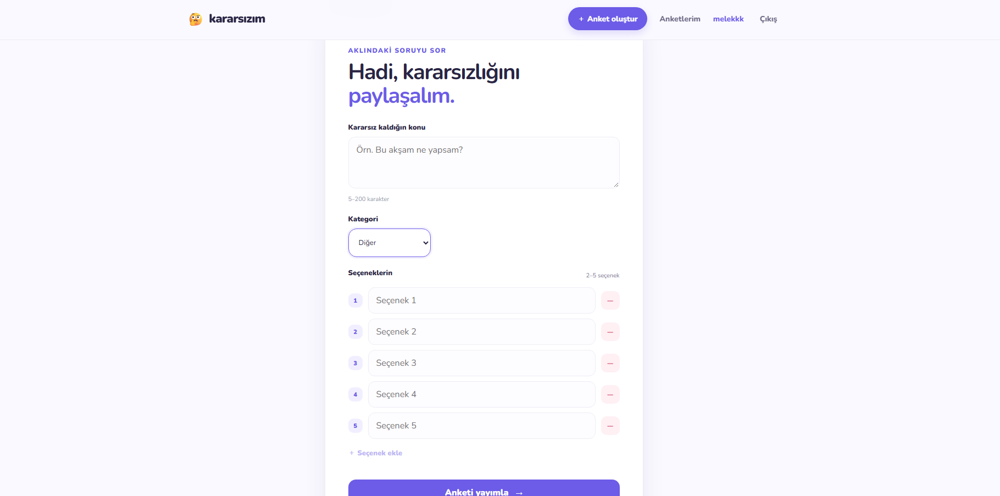
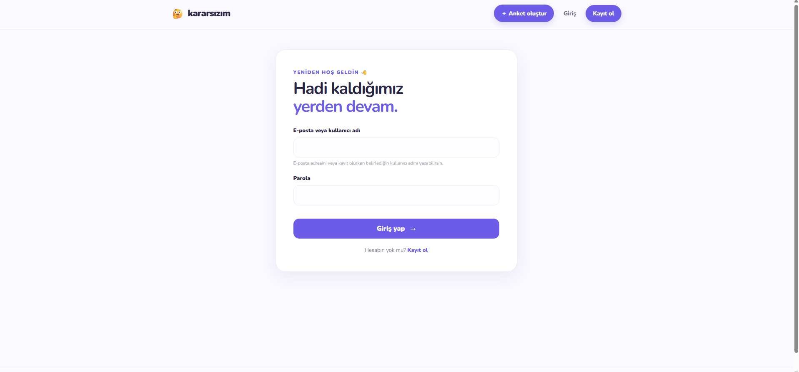

# kararsızım

Kararsız kaldığın konuları ankete dönüştür, topluluğun oylarıyla karar ver. Üye olmadan anketleri görüntüleyip oy kullanabilir; anket oluşturmak için hesap açabilirsin.

> **Teknolojiler:** Python 3.14 · Django 5.2 LTS · Supabase PostgreSQL · Django Templates · HTML · CSS · Vanilla JavaScript

## Ekran görüntüleri

### Ana sayfa


### Anket oluşturma



### Giriş



## Özellikler

- E-posta veya kullanıcı adıyla kayıt ve giriş
- Üye olmadan anketleri görüntüleme ve oy kullanma
- Anket sorusu ve seçenek metinlerinde kelime arama
- Anketleri kategoriye göre filtreleme
- Üyeler için 2–5 seçenekli anket oluşturma
- Oy kullandıktan sonra sonuçları ve katılım oranlarını görme
- En çok katılım alan anketleri ana sayfada listeleme
- Anket sahibi için oy kullanma ve anketlerini yönetme
- Mobil uyumlu Türkçe arayüz

## Kullanılan teknolojiler

- **Python 3.14** ve **Django 5.2 LTS** — sunucu tarafı ve uygulama çatısı
- **Supabase PostgreSQL** — veritabanı
- **Django Templates**, **HTML5** ve **CSS3** — sayfalar ve arayüz
- **Vanilla JavaScript** — dinamik anket seçenekleri ve sayfa yenilemeden oy verme
- **Django Authentication ve Sessions** — hesaplar ve oturum yönetimi
- **psycopg** ve **dj-database-url** — PostgreSQL bağlantısı

## Yerel ortamda çalıştırma

1. Python 3.14 sanal ortamı oluşturup etkinleştir:

   ```powershell
   py -3.14 -m venv .venv
   .\.venv\Scripts\Activate.ps1
   ```

2. Bağımlılıkları yükle:

   ```powershell
   pip install -r requirements.txt
   ```

3. `.env.example` dosyasını `.env` olarak kopyala. `SECRET_KEY` ve `DATABASE_URL` değerlerini kendi ortamına göre doldur. Veritabanı için Supabase PostgreSQL Transaction pooler bağlantısını kullan. Gerçek sırları GitHub'a yükleme.

4. Tabloları oluşturup sunucuyu başlat:

   ```powershell
   python manage.py migrate
   python manage.py runserver
   ```

Uygulama varsayılan olarak `http://127.0.0.1:8000/` adresinde açılır.
